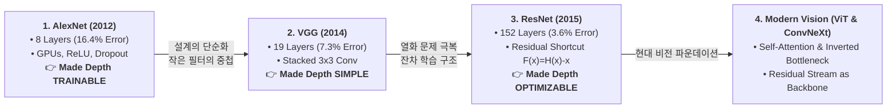
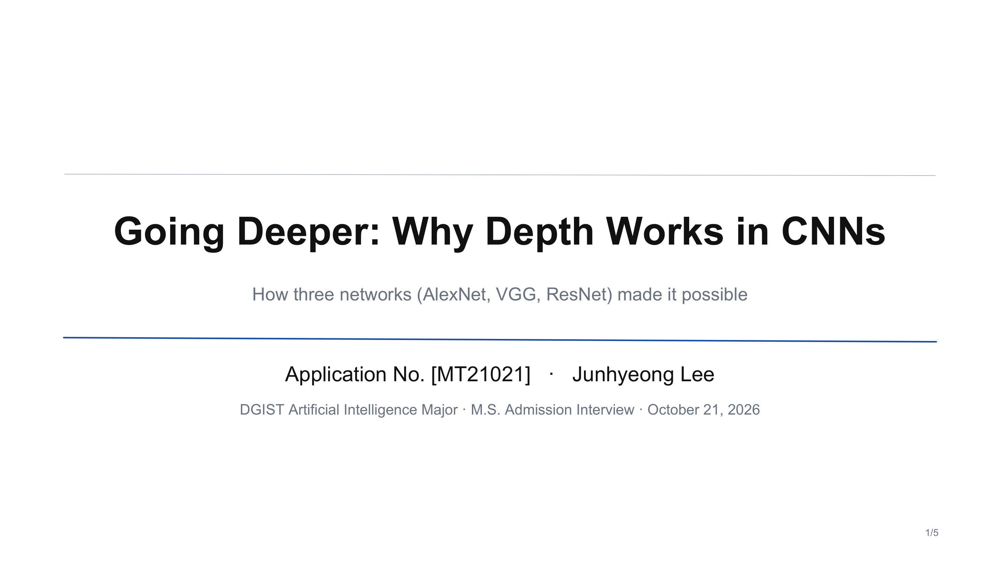
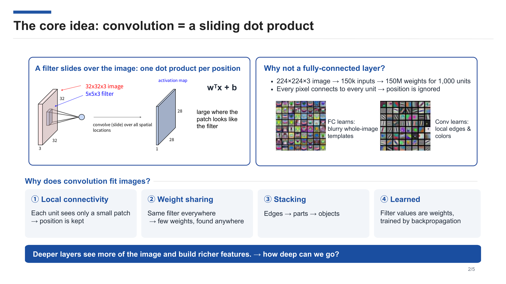
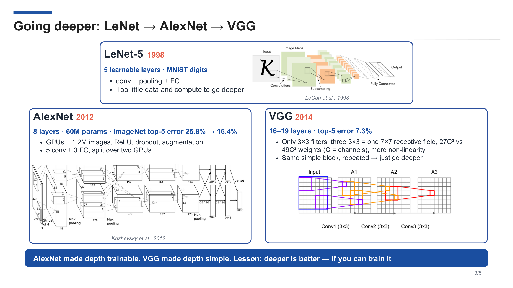
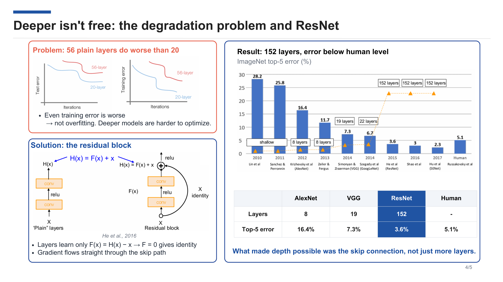
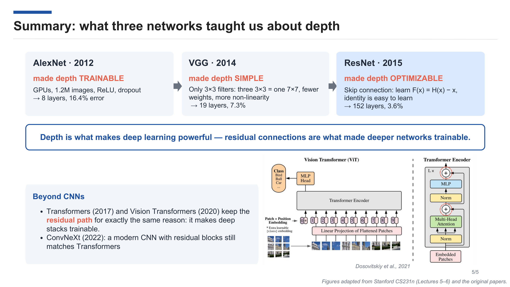

# 🚀 Going Deeper: Why Depth Works in CNNs
> **How Three Landmark Networks (AlexNet, VGG, ResNet) Made Deep Hierarchies Trainable, Simple, and Optimizable**

  
  
  
  
  
  

---

## 📌 Executive Summary

본 발표 자료는 **DGIST 인공지능전공(Artificial Intelligence Major) 석사과정 구술 면접(2026년 10월 21일)**을 위해 준비된 5장 분량의 영어 학술 발표입니다.

컴퓨터 비전 딥러닝 혁신의 핵심 원동력인 **"네트워크의 깊이(Depth)"**가 왜 시각 표현 학습에 유효한지, 그리고 단순한 깊이 확장이 봉착했던 최적화 한계(Optimization Degradation)를 세 가지 획기적인 아키텍처(**AlexNet $\rightarrow$ VGG $\rightarrow$ ResNet**)가 각각 어떠한 메커니즘으로 해결했는지를 압축적으로 규명합니다. 나아가 이 철학이 현대의 **Vision Transformer (ViT)** 및 **ConvNeXt**로 계승되는 지평까지 연결합니다.

---

## 📑 Slide-by-Slide Breakdown & English Presentation Script

- **권장 발표 시간**: 약 7~8분 (슬라이드당 약 1분 30초 내외)
- **발표 톤앤매너**: 자신감 있고 명확한 학술적 영어 구사 (Academic & Professional)

---

### Slide 1: Title & Introduction

  

#### 💡 Core Objective
- 지원자의 신원(수험번호 `MT21021`, 이름 이준형)과 발표 주제의 명확한 전달.
- 단순한 아키텍처 나열이 아니라, **"Why Depth Works"**와 **"How Three Networks Made It Possible"**이라는 핵심 질문을 청중에게 던지며 집중을 유도.

#### 🎙️ English Oral Script
> *"Good morning, distinguished professors and committee members.  
> My name is **Junhyeong Lee**, application number **MT21021**.  
> It is a great honor to present my talk for admission to the **DGIST Artificial Intelligence Major**.  
> 
> Today, I would like to talk about **'Going Deeper: Why Depth Works in CNNs'**, and how three landmark networks—**AlexNet, VGG, and ResNet**—fundamentally made deep representation learning possible.  
> 
> In deep learning, we often take depth for granted. However, training deeper networks was once considered nearly impossible due to computational limits and optimization hurdles. In the next few minutes, I will trace this evolutionary journey and show how depth transformed from an intractable challenge into the cornerstone of modern computer vision.  
> 
> Let us begin with the foundational operation: convolution."*

---

### Slide 2: The Core Idea — Convolution as a Sliding Dot Product

  

#### 💡 Key Concepts & Theoretical Insights
1. **Mathematical Formulation**:
   $$y = w^T x + b$$
   - 각 위치마다 로컬 패치와 필터 가중치 간의 점곱(Inner Product) 연산 수행. 필터와 패치의 시각적 패턴이 일치할 때 높은 활성화 값 출력.
2. **FC Layer vs. Conv Layer**:
   - $224 \times 224 \times 3$ 이미지 기준: 단 1개의 FC 은닉층(1,000 유닛)만 두어도 $150\text{k} \times 1,000 \approx 150\text{M}$ 파라미터 폭증 $\rightarrow$ 심각한 과적합 및 공간적 위치 정보 소실 (Blurry template 학습).
3. **Four Pillars of Convolution**:
   - **Local Connectivity**: 각 뉴런이 작은 수용영역(Receptive field)만 봄으로써 공간적 기하 정보 보존.
   - **Weight Sharing**: 동일한 필터를 전체 이미지에 슬라이딩 $\rightarrow$ 파라미터 수의 극적 감소 및 Translation Equivariance 확보.
   - **Stacking**: 레이어가 깊어질수록 Receptive Field가 누적 확장되며 `Low-level Edges` $\rightarrow$ `Mid-level Parts` $\rightarrow$ `High-level Semantic Objects`의 계층적 추상화 형성.
   - **Learned via Backpropagation**: 하드코딩된 핸드크래프트 필터(Sobel, Gabor 등)가 아닌 데이터로부터 최적의 필터를 엔드투엔드로 학습.

#### 🎙️ English Oral Script
> *"To understand why depth matters, we must first look at the core building block: **convolution**.  
> Mathematically, convolution is simply a sliding dot product: $w^T x + b$. It yields a high response wherever an image patch matches the filter pattern.  
> 
> Why can’t we just use fully connected layers?  
> Consider a standard 224 by 224 RGB image. That is about 150,000 input values. Connecting this to just 1,000 hidden units requires **150 million parameters** in a single layer! More critically, fully connected layers destroy spatial structure, merely memorizing blurry global templates.  
> 
> Convolution elegantly solves this through four key principles:  
> First, **Local connectivity** preserves 2D spatial context.  
> Second, **Weight sharing** dramatically cuts down parameters while detecting features anywhere in the scene.  
> Third, **Stacking** allows features to build up hierarchically—from simple edges to object parts, and eventually to full semantic concepts.  
> And fourth, these filters are **fully learnable** through end-to-end backpropagation.  
> 
> Because deeper layers see larger receptive fields and compose richer representations, an obvious question arises: **How deep can we actually go?** Let’s look at how the community answered this."*

---

### Slide 3: Going Deeper — LeNet $\rightarrow$ AlexNet $\rightarrow$ VGG

  

#### 💡 Key Concepts & Comparative Analysis
| Architecture | Year | Depth | Top-5 Error | Key Breakthroughs & Architectural Shift |
|:---:|:---:|:---:|:---:|:---|
| **LeNet-5** | 1998 | 5 layers | (MNIST) | First practical ConvNet; limited by small data & compute. |
| **AlexNet** | 2012 | 8 layers | **16.4%** (vs 25.8%) | **Made depth TRAINABLE**. Dual GPU parallelization, 1.2M ImageNet, ReLU (prevented saturation), Dropout (regularization), Data Augmentation. |
| **VGGNet** | 2014 | 16–19 layers | **7.3%** | **Made depth SIMPLE**. Replaced large filters ($11\times11, 7\times7$) with repeated stacks of tiny $3\times3$ filters. |

- **Mathematical Proof of $3\times3$ Stacking**:
  - 세 개의 $3\times3$ 합성곱 레이어를 연속으로 쌓으면, 유효 수용영역(Effective Receptive Field)은 정확히 하나의 $7\times7$ 레이어와 동일해집니다 ($1 + 3 \times (3 - 1) = 7$).
  - **파라미터 수 비교**: 채널 수가 $C$일 때,
    - 단일 $7\times7$ Conv: $7 \times 7 \times C^2 = \mathbf{49C^2}$
    - 3개의 $3\times3$ Conv: $3 \times (3 \times 3 \times C^2) = \mathbf{27C^2}$ $\rightarrow$ **약 45% 파라미터 절감!**
  - **비선형성 증가**: 레이어 사이에 ReLU 활성화 함수가 3번 들어가므로 결정 경계(Decision Boundary)의 표현력이 훨씬 풍부해짐.

#### 🎙️ English Oral Script
> *"Back in 1998, Yann LeCun’s **LeNet-5** established the conv-pool-FC pipeline with 5 learnable layers. But at that time, we simply lacked the data and computational power to go any deeper.  
> 
> That all changed in 2012 with **AlexNet**.  
> By harnessing GPUs and the 1.2-million-image ImageNet dataset, AlexNet proved that an 8-layer network could slash the top-5 error from 25.8% down to 16.4%. Crucially, AlexNet introduced **ReLU activations** to prevent gradient saturation, along with **dropout and data augmentation** to combat overfitting. In short, **AlexNet made depth trainable**.  
> 
> Two years later, in 2014, **VGG** took a major leap to 19 layers, achieving an impressive 7.3% error rate.  
> VGG’s genius was architectural simplicity: it discarded large, heterogeneous kernels like 11-by-11 and used **only 3-by-3 filters**.  
> Stack three 3-by-3 conv layers, and you get the exact same 7-by-7 receptive field—but with **27C-squared parameters instead of 49C-squared**, a 45% reduction, while inserting three non-linear ReLU activations instead of one.  
> 
> VGG proved that modular, homogeneous depth is remarkably effective. **VGG made depth simple**.  
> The prevailing lesson seemed clear: *deeper is always better—if only you can train it.*  
> But what happens when we try to push past 20 or 30 layers?"*

---

### Slide 4: Deeper Isn't Free — The Degradation Problem and ResNet

  

#### 💡 Key Concepts & Theoretical Insights
1. **The Degradation Problem**:
   - 레이어를 20층에서 56층으로 단순히 더 쌓았더니(Plain Net), 테스트 오차뿐만 아니라 **학습 오차(Training Error)**까지 오히려 크게 증가함.
   - 이는 **과적합(Overfitting)이 아님** (과적합이라면 학습 오차는 낮고 테스트 오차만 높아야 함).
   - 기울기 소실(Vanishing Gradient)도 배치 정규화(Batch Normalization)로 이미 완화된 상태였음 $\rightarrow$ 근본적인 원인은 **깊은 비선형 네트워크의 최적화 난제(Optimization Difficulty)**.
2. **The Residual Formulation**:
   - 목적 함수 $H(x)$를 직접 매핑하는 대신, 잔차(Residual) 함수 $F(x) = H(x) - x$를 학습하도록 재구성.
   - 출력: $H(x) = F(x) + x$
   - 만약 항등 매핑(Identity Mapping)이 최적이라면, 여러 비선형 레이어가 $H(x)=x$를 학습하는 것은 극히 어렵지만, **$F(x) \rightarrow 0$으로 가중치를 0으로 수렴시키는 것은 매우 용이함**.
3. **Gradient Highway (역전파의 고속도로)**:
   - 손실함수 $\mathcal{E}$에 대해 역전파 시:
     $$\frac{\partial \mathcal{E}}{\partial x} = \frac{\partial \mathcal{E}}{\partial H} \cdot \left(\frac{\partial F}{\partial x} + 1\right)$$
   - 스킵 연결 덕분에 우변에 항상 **$+1$ 항이 보존**되므로, 아무리 레이어가 깊어져도 상위층의 그래디언트가 손실 없이 하위층으로 직통 전달됨.
4. **결과**:
   - 152층의 초심층 네트워크 학습 성공.
   - ImageNet Top-5 Error **3.6%** 달성 $\rightarrow$ **인간 시각 인지 오차율(Human Error: 5.1%)을 인공지능 역사상 최초로 갱신**.

#### 🎙️ English Oral Script
> *"As researchers pushed deeper, they ran into a wall: the notorious **degradation problem**.  
> When stacking 56 plain convolutional layers, the network performed noticeably worse than a 20-layer network. Crucially, as shown in the top graph, even the **training error was worse**. This proved it was not overfitting—deeper models were simply much harder to optimize.  
> 
> In 2015, Kaiming He and his team introduced the **Residual Block**.  
> Instead of forcing stacked layers to fit an underlying mapping $H(x)$, they let the layers learn the residual: **$F(x) = H(x) - x$**, so the output becomes **$F(x) + x$**.  
> If an identity mapping is optimal, driving $F(x)$ to zero is trivial for gradient descent, whereas fitting an identity function through multiple non-linear layers is nearly impossible.  
> 
> Furthermore, the identity shortcut acts as a **gradient highway**. During backpropagation, the gradient flows directly through the addition operator with an additive factor of plus one, entirely bypassing vanishing gradients.  
> 
> With this breakthrough, ResNet scaled up to **152 layers**, plummeting the ImageNet error rate to **3.6%**—surpassing human-level performance for the first time in history.  
> The takeaway is profound: **what made extreme depth possible was not just stacking layers, but the shortcut connection itself. ResNet made depth optimizable.**"*

---

### Slide 5: Summary — What Three Networks Taught Us & Beyond CNNs

  

#### 💡 Key Concepts & Modern Extensions
1. **The 3-Step Paradigm Evolution**:
   - **AlexNet (2012)**: *Made Depth TRAINABLE* (GPUs, 1.2M ImageNet, ReLU, Dropout $\rightarrow$ 8 layers, 16.4%)
   - **VGG (2014)**: *Made Depth SIMPLE* (Modular $3\times3$ stacking, parameter efficiency $\rightarrow$ 19 layers, 7.3%)
   - **ResNet (2015)**: *Made Depth OPTIMIZABLE* (Residual learning, identity gradient shortcut $\rightarrow$ 152 layers, 3.6%)
2. **Beyond CNNs — The Modern AI Landscape**:
   - **Transformers (2017) & Vision Transformers (ViT, 2020)**:
     - ViT는 합성곱의 고유 유도 편향(Inductive Bias: Local connectivity, Translation equivariance)을 배제하고 Self-Attention으로 전환했으나, **블록마다 Residual Shortcut을 두는 핵심 메커니즘은 100% 동일하게 유지**. 잔차 연결 없이는 24개 이상의 트랜스포머 블록 학습이 불가능함.
   - **ConvNeXt (2022)**:
     - 트랜스포머의 설계 기법(Inverted Bottleneck, $7\times7$ Depthwise Conv, LayerNorm 등)을 순수 CNN에 역이식한 현대적 합성곱 모델. 여전히 ResNet의 Residual Block 철학을 기반으로 최신 트랜스포머와 대등하거나 능가하는 성능 입증.
3. **Core Conclusion**:
   > *"Depth is what makes deep learning powerful — residual connections are what made deeper networks trainable."*

#### 🎙️ English Oral Script
> *"To summarize: what did these three iconic networks teach us about depth?  
> 
> - **AlexNet (2012)** showed us how to make depth **trainable** with GPUs, ReLU, and regularization.  
> - **VGG (2014)** showed us how to make depth **simple**, establishing the modular 3-by-3 filter paradigm that became standard practice.  
> - **ResNet (2015)** solved the fundamental degradation problem, making depth truly **optimizable** through residual shortcuts.  
> 
> Today, the impact of residual learning reaches far beyond traditional CNNs:  
> When the **Vision Transformer (ViT)** was introduced in 2020, it abandoned convolutional inductive biases in favor of global patch self-attention—yet it retained residual shortcuts across every single block. Without this skip path, deep multi-head attention blocks cannot be trained.  
> Furthermore, modern architectures like **ConvNeXt (2022)** demonstrated that a modernized CNN equipped with residual paths still competes head-to-head with state-of-the-art Transformers.  
> 
> In conclusion: **Depth is what gives deep learning its expressive power, but it was the residual connection that unlocked scalable training across all of modern AI.**  
> 
> Thank you very much for your time and attention. I am now eager to answer any questions."*

---

## 🎯 Anticipated DGIST Interview Q&A (교수님 예상 질문 및 모범 영어 답변)

DGIST 인공지능전공 구술 면접 시 배인환 교수님 및 면접 위원 교수님들께서 심층적으로 질문하실 수 있는 핵심 질문 6선과 이에 대한 학술적이고 정교한 영어 모범 답변입니다.

---

### Q1. "In Slide 4, you mentioned that the degradation problem is NOT overfitting. Could you explain the exact theoretical difference between overfitting and degradation?"
> **면접관 의도**: 오버피팅과 모델 최적화 난해성(Optimization Degradation)의 개념적 차이를 명확히 이해하고 있는지 확인.

#### 💡 Model English Answer
> *"Certainly, Professor.  
> In classical machine learning, **overfitting** occurs when a model has excessive capacity relative to the dataset, leading to very low training error but poor generalization on test data.  
> 
> In contrast, what He et al. observed in the **degradation problem** was that when depth increased from 20 to 56 plain layers, the **training error itself was significantly higher**, not just the test error.  
> If an $N$-layer network can achieve a certain training loss, an $(N+M)$-layer network should theoretically achieve at least equal or lower training error simply by setting the extra $M$ layers to identity mappings. The fact that the solver failed to find even this identity solution indicates that standard gradient descent struggles to optimize deep compositions of non-linear functions. Thus, degradation is fundamentally an **optimization failure**, not a lack of generalization or overfitting."*

---

### Q2. "VGG replaced $7\times7$ and $11\times11$ convolutions with stacks of $3\times3$ filters. Why don't we use even smaller filters, like $1\times1$ or $2\times2$ exclusively?"
> **면접관 의도**: 필터 크기, 수용영역(Receptive field), 공간적 컨텍스트(Spatial context)의 상호작용 이해도 평가.

#### 💡 Model English Answer
> *"That is an excellent point.  
> A $3\times3$ filter is the smallest 2D spatial window that possesses a well-defined **center pixel** surrounded by an 8-neighborhood (up, down, left, right, and diagonals).  
> 
> While a $1\times1$ convolution is computationally efficient and introduces non-linearity, it operates strictly along the channel dimension without capturing any spatial context.  
> On the other hand, an even filter like $2\times2$ lacks structural symmetry around a central coordinate, which can cause geometric bias and spatial distortion when padded and stacked across many layers.  
> 
> Therefore, a stack of $3\times3$ filters provides the optimal trade-off: it preserves central symmetry, captures minimal local spatial geometry, allows modular receptive field expansion, and minimizes parameters while inserting more non-linear activations."*

---

### Q3. "Can you write down or explain mathematically why the gradient does not vanish through the ResNet residual path?"
> **면접관 의도**: 잔차 연결의 역전파 수식($\frac{\partial \mathcal{E}}{\partial x_l}$)에 대한 수학적 이해도 검증.

#### 💡 Model English Answer
> *"Yes, Professor.  
> Let the output of a residual unit be $x_{l+1} = x_l + \mathcal{F}(x_l, \mathcal{W}_l)$.  
> Recursively applying this from layer $l$ to an arbitrary deeper layer $L$, the feature representation can be expressed as:
> $$x_L = x_l + \sum_{i=l}^{L-1} \mathcal{F}(x_i, \mathcal{W}_i)$$
> 
> When we compute the gradient of the total loss $\mathcal{E}$ with respect to the earlier activation $x_l$ using the chain rule, we obtain:
> $$\frac{\partial \mathcal{E}}{\partial x_l} = \frac{\partial \mathcal{E}}{\partial x_L} \cdot \frac{\partial x_L}{\partial x_l} = \frac{\partial \mathcal{E}}{\partial x_L} \left( \mathbf{1} + \frac{\partial}{\partial x_l} \sum_{i=l}^{L-1} \mathcal{F}(x_i, \mathcal{W}_i) \right)$$
> 
> The key is the term **$\mathbf{1}$** inside the parentheses. Even if the gradient through the learned weight path $\frac{\partial}{\partial x_l} \sum \mathcal{F}$ becomes extremely small or vanishes, the gradient $\frac{\partial \mathcal{E}}{\partial x_L}$ is directly propagated back to layer $l$ intact through the identity path. This guarantees that earlier layers continue to receive strong gradient signals throughout training."*

---

### Q4. "Before ResNet, Batch Normalization (BN) was introduced in 2015 to fix internal covariate shift and vanishing gradients. Why was BN alone insufficient to train 100+ layer networks?"
> **면접관 의도**: 배치 정규화(BN)의 역할과 잔차 연결(Residual Connection)의 차별적 역할 규명 능력 확인.

#### 💡 Model English Answer
> *"Batch Normalization was indeed a groundbreaking milestone that largely mitigated vanishing and exploding gradients by ensuring zero mean and unit variance across mini-batches. In fact, both the 20-layer and 56-layer networks in the ResNet paper were trained with Batch Normalization.  
> 
> However, BN addresses the **forward and backward scale of activations and gradients**, but it does not alter the functional topology of the optimization landscape. As non-linear plain layers are multiplied recursively, the loss surface develops highly irregular, non-convex curvatures and chaotic plateaus where gradient descent gets trapped.  
> 
> ResNet reshapes the optimization landscape itself. By making identity mapping the default baseline ($F(x)=0$), the skip connection flattens the loss surface, transforming an intractable high-dimensional search into a smooth, convex-like residual perturbation."*

---

### Q5. "In your final slide, you mentioned Vision Transformers and ConvNeXt. How do their residual mechanisms compare to classical ResNet?"
> **면접관 의도**: 전통적 CNN의 지식을 최신 파운데이션 모델(ViT, ConvNeXt)로 연결하는 확장적 사고력 평가.

#### 💡 Model English Answer
> *"In classical ResNet, the residual block performs post-activation or pre-activation around convolutional layers with batch normalization.  
> 
> When Vision Transformers (ViT) were introduced, they preserved this residual stream as the central backbone. However, instead of convolutions, the residual perturbations are computed via Multi-Head Self-Attention (MHSA) and MLP blocks, wrapped with **Pre-LayerNorm**. The residual connection allows tokens to retain their identity while accumulating contextual updates across attention heads.  
> 
> ConvNeXt then closed the loop in 2022. It adopted ViT’s design choices—such as an inverted bottleneck, depthwise separable convolutions with large 7x7 kernels, and fewer activation layers—while anchoring the entire macro-design on ResNet-style residual blocks.  
> Both models affirm that whether the token mixing operation is convolution or self-attention, the **residual highway is the universal prerequisite** for deep model scaling."*

---

### Q6. "How does this study on CNN depth connect to your future research interest in our laboratory at DGIST?"
> **면접관 의도**: 지원 동기와 연구실 세부 연구 분야(배인환 교수님 연구실의 컴퓨터 비전, VLM, 공간 추론 등)와의 정합성 확인.

#### 💡 Model English Answer
> *"Throughout my undergraduate research in spatiotemporal deep learning and Vision-Language Models, I observed that extracting robust, fine-grained geometric features from visual inputs is the single most critical bottleneck.  
> 
> Understanding the inductive biases of CNNs—specifically how local receptive fields build hierarchical representations and how residual paths preserve information fidelity—gives me deep intuition when working with multimodal architectures.  
> In DGIST's Artificial Intelligence graduate program, I aspire to build upon these foundational principles to research **3D spatial reasoning, geometry-grounded foundation models, and robust visual representation learning**. Having mastered the core evolution of vision architectures from AlexNet to modern Transformers, I am thoroughly prepared to contribute to cutting-edge vision research under your guidance."*

---

## 📂 Presentation Materials & File Index

| File Name | Format | Size | Description |
|:---|:---:|:---:|:---|
| [📄 `DGIST_Interview_GoingDeeper_JunhyeongLee.pdf`](./DGIST_Interview_GoingDeeper_JunhyeongLee.pdf) | PDF | 1.6 MB | 5장 슬라이드 공식 발표용 PDF 파일 |
| [📊 `DGIST_Interview_GoingDeeper_JunhyeongLee.pptx`](./DGIST_Interview_GoingDeeper_JunhyeongLee.pptx) | PPTX | 2.0 MB | 원본 파워포인트 발표 슬라이드 |
| [🖼️ `images/slide_1.png`](./images/slide_1.png) | PNG (2880x1620) | ~96 KB | Slide 1 고화질 프리뷰 |
| [🖼️ `images/slide_2.png`](./images/slide_2.png) | PNG (2880x1620) | ~732 KB | Slide 2 고화질 프리뷰 |
| [🖼️ `images/slide_3.png`](./images/slide_3.png) | PNG (2880x1620) | ~528 KB | Slide 3 고화질 프리뷰 |
| [🖼️ `images/slide_4.png`](./images/slide_4.png) | PNG (2880x1620) | ~465 KB | Slide 4 고화질 프리뷰 |
| [🖼️ `images/slide_5.png`](./images/slide_5.png) | PNG (2880x1620) | ~703 KB | Slide 5 고화질 프리뷰 |

---

## 📚 References & Academic Citations

1. **AlexNet**: Krizhevsky, A., Sutskever, I., & Hinton, G. E. (2012). *ImageNet classification with deep convolutional neural networks*. Advances in Neural Information Processing Systems (NeurIPS 2012).
2. **VGGNet**: Simonyan, K., & Zisserman, A. (2014). *Very deep convolutional networks for large-scale image recognition*. arXiv:1409.1556 (ICLR 2015).
3. **ResNet**: He, K., Zhang, X., Ren, S., & Sun, J. (2016). *Deep residual learning for image recognition*. IEEE Conference on Computer Vision and Pattern Recognition (CVPR 2016, Best Paper Award).
4. **ViT**: Dosovitskiy, A., et al. (2020). *An image is worth 16x16 words: Transformers for image recognition at scale*. ICLR 2021.
5. **ConvNeXt**: Liu, Z., et al. (2022). *A ConvNet for the 2020s*. CVPR 2022.
6. **Stanford CS231n**: *Convolutional Neural Networks for Visual Recognition* (Lectures 5–6: Convolutional Architectures).
